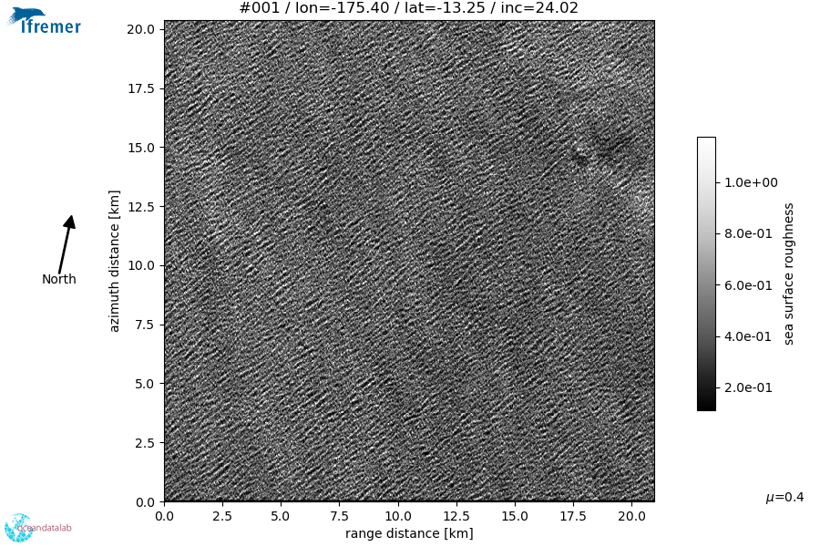
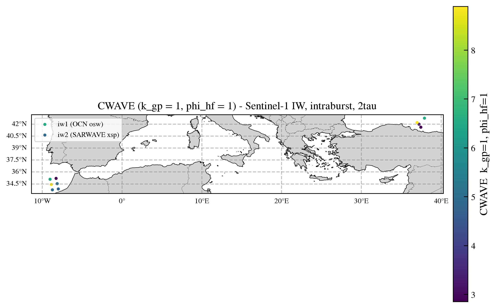

Certification
=============

.. _certification:

This page certifies that the CWAVE kernels are consistent with the structure of
real SAR ocean cross-spectra, and shows a full georeferenced CWAVE map produced
by the task-10 script.

From surface roughness to CWAVE on real data
--------------------------------------------

The chain is : the sea-surface roughness modulates the radar backscatter
:math:`\sigma^0`, which the SAR cross-spectra represent in the wavenumber
domain, from which the CWAVE parameters are extracted. All the figures below
come from the **same S1A WV1 acquisition** (2025-05-01, orbit 058996_075117).

SAR roughness
~~~~~~~~~~~~~

   SAR :math:`\sigma^0` roughness image of the sea surface (S1A WV1, VV). The
   modulations of this surface are what the cross-spectra below encode in the
   wavenumber domain.

Cross-spectra and CWAVE kernels
~~~~~~~~~~~~~~~~~~~~~~~~~~~~~~~

Each of the three figures below shows, for one decode method, three panels : the
modulus :math:`|X_S|`, the same spectrum with the CWAVE kernel
(:math:`k_{gp}=1`, :math:`\varphi_{hf}=1`) **superimposed** as contours, and the
**pointwise integrand** :math:`\text{kernel} \times |X_S|_{\text{norm}}` that is
summed over the domain to yield the CWAVE parameter (the intermediate step of
:func:`cwaves.compute_cwaves.compute_cwave_parameters`). All three are plotted
on the **same display domain** :math:`k_x \in [0, k_{max}]`,
:math:`k_y \in [-k_{max}, k_{max}]` (black = zero spectrum), so the panels are
directly comparable.

* **OCN WV, polar → cartesian** (``oswPolSpec`` resampled to a cartesian grid,
  :func:`cwaves.client.polar_to_cartesian`) :

  .. figure:: figures/certification_ocn_polar.png
     :align: center
     :width: 100%

* **OCN WV, cartesian-sinh → regular** (``oswCartSpec`` sinh grid decompressed
  to a regular one-sided grid in rad/m,
  :func:`cwaves.ocn_sinh.compute_ocn_sinh_cartesian`) :

  .. figure:: figures/certification_ocn_sinh.png
     :align: center
     :width: 100%

* **SARWAVE L1B XSP** (the self-contained ``xspectra_2tau`` cross-spectrum,
  :func:`cwaves.compute_cwaves_from_l1b`) :

  .. figure:: figures/certification_xsp.png
     :align: center
     :width: 100%

In each figure, the middle panel overlays the CWAVE kernel contours (cyan) on
:math:`|X_S|` -- the kernel ellipses are elongated along the range direction
(:math:`k_x`), matching the spectral structure -- and the right panel shows the
integrand, whose sum over the domain is the CWAVE value in the title.

The elliptic, range-elongated support of the kernel follows the domain :math:`A`
and is consistent with the dominant lobes of the cross-spectra, which is the
intended behaviour of the orthonormal basis on :math:`A`.

Georeferenced CWAVE map
-----------------------

The figure below is a georeferenced map of the CWAVE parameter
(:math:`k_{gp}=1`, :math:`\varphi_{hf}=1`) produced by the task-10 script
(:mod:`cwaves.scripts.iw_cwaves_map`) on two Sentinel-1 IW product families :
the ESA OCN WV IW osw fixture (``iw1``) and the SARWAVE L1B XSP fixture
(``iw2``).

   Georeferenced CWAVE map (:math:`k_{gp}=1`, :math:`\varphi_{hf}=1`),
   intraburst, lag 2. Each point is one tile; the two clusters correspond to the
   two (reduced) fixture products.

The map is rendered with ``cartopy`` (the ``scripts`` extra) with labeled
longitude/latitude gridlines; the colour scale is shared across subswaths.

Reproducing the figures
-----------------------

Both figures are generated by :file:`docs/generate_figures.py` :

.. code-block:: bash

   python docs/generate_figures.py

The map figure requires the ``scripts`` extra (``pip install "cwaves[scripts]"``
for ``cartopy``). The source fixtures are shipped in :file:`assets/`.
