Certification
=============

.. _certification:

This page certifies that the CWAVE kernels are consistent with the structure of
real SAR ocean cross-spectra, and shows full georeferenced CWAVE maps produced
by the :mod:`cwaves.scripts.iw_cwaves_map` script.

From surface roughness to CWAVE on real data
--------------------------------------------

The chain is : the sea-surface roughness modulates the radar backscatter
:math:`\sigma^0`, which the SAR cross-spectra represent in the wavenumber
domain, from which the CWAVE parameters are extracted. All the figures below
come from the **same S1A WV1 acquisition** (2025-05-01, orbit 058996_075117,
OCN WV measurement base name
``s1a-wv1-ocn-vv-20250501t060101-058996-075117-001``, derived from the SLC
``S1A_WV_SLC__1SSV_20250501T060101_20250501T061923_058996_075117_DD24``).

SAR roughness
~~~~~~~~~~~~~

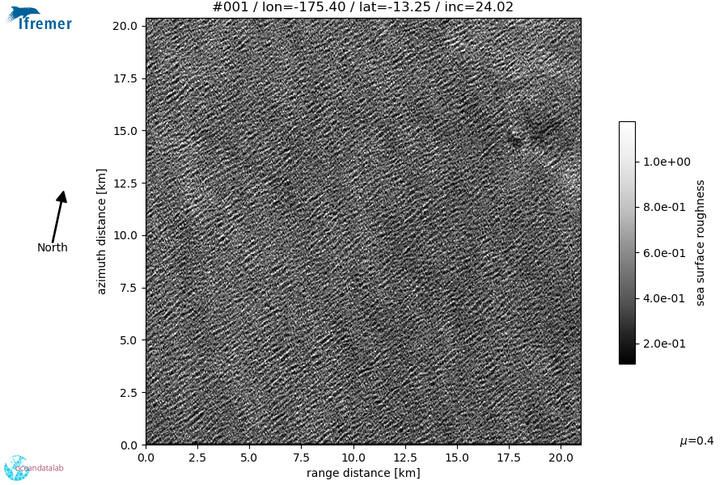

   SAR :math:`\sigma^0` roughness image of the sea surface (S1A WV1, VV). The
   modulations of this surface are what the cross-spectra below encode in the
   wavenumber domain.

Cross-spectra and CWAVE kernels
~~~~~~~~~~~~~~~~~~~~~~~~~~~~~~~

Each of the three figures below shows, for one decode method, three panels : the
modulus :math:`|X_S|`, the same spectrum with the CWAVE kernel
(:math:`k_{gp}=1`, :math:`\varphi_{hf}=1`) **superimposed** as contours, and the
**pointwise integrand** :math:`\text{kernel} \times |X_S|_{\text{norm}}` that is
summed over the domain to yield the CWAVE parameter (the intermediate step of
:func:`cwaves.compute_cwaves.compute_cwave_parameters`). All three are plotted
on the **same display domain** :math:`k_x \in [0, k_{max}]`,
:math:`k_y \in [-k_{max}, k_{max}]` (black = zero spectrum), so the panels are
directly comparable.

* **OCN WV, polar → cartesian** (``oswPolSpec`` resampled to a cartesian grid,
  :func:`cwaves.client.polar_to_cartesian`) :

  .. figure:: figures/certification_ocn_polar.png
     :align: center
     :width: 100%

* **OCN WV, cartesian-sinh → regular** (``oswCartSpec`` sinh grid decompressed
  to a regular one-sided grid in rad/m,
  :func:`cwaves.ocn_sinh.compute_ocn_sinh_cartesian`) :

  .. figure:: figures/certification_ocn_sinh.png
     :align: center
     :width: 100%

* **SARWAVE L1B XSP** (the self-contained ``xspectra_2tau`` cross-spectrum,
  :func:`cwaves.compute_cwaves_from_l1b`) :

  .. figure:: figures/certification_xsp.png
     :align: center
     :width: 100%

In each figure, the middle panel overlays the CWAVE kernel contours (cyan) on
:math:`|X_S|` -- the kernel ellipses are elongated along the range direction
(:math:`k_x`), matching the spectral structure -- and the right panel shows the
integrand, whose sum over the domain is the CWAVE value in the title.

The elliptic, range-elongated support of the kernel follows the domain :math:`A`
and is consistent with the dominant lobes of the cross-spectra, which is the
intended behaviour of the orthonormal basis on :math:`A`.

Full CWAVE basis (all 20 parameters)
~~~~~~~~~~~~~~~~~~~~~~~~~~~~~~~~~~~~

The three figures below render the **entire default CWAVE basis**
(:math:`N_k = 4` Gegenbauer x :math:`N_\varphi = 5` harmonic = 20 parameters)
for each decode method, on the same S1A WV1 acquisition as above. Each panel is
the pointwise integrand :math:`\text{kernel}_{(k_{gp},\,\varphi_{hf})} \times
|X_S|_{\rm norm}` for one parameter, with the resulting CWAVE value in the
title; the colour scale is shared (and symmetric) across all panels of a method,
with its bounds set to the 90 % central interval (5th-95th percentile) of the
absolute integrand so that isolated kernel peaks do not wash out the bulk of
the data. This makes the 20-parameter output of the three decode methods
directly comparable.

* **OCN WV, polar → cartesian** :

  .. figure:: figures/certification_all_ocn_polar.png
     :align: center
     :width: 100%

* **OCN WV, cartesian-sinh → regular** :

  .. figure:: figures/certification_all_ocn_sinh.png
     :align: center
     :width: 100%

* **SARWAVE L1B XSP** :

  .. figure:: figures/certification_all_xsp.png
     :align: center
     :width: 100%

Round-trip reconstruction (back-and-forth)
~~~~~~~~~~~~~~~~~~~~~~~~~~~~~~~~~~~~~~~~~~

This section certifies that the CWAVE decomposition and the spectrum
reconstruction from the CWAVE coefficients form a consistent back-and-forth.
The same S1A WV1 cross-spectrum (SARWAVE L1B XSP, normalised modulus
:math:`|X_S|` on the one-sided domain :math:`A`) is decomposed into CWAVE
coefficients by :func:`cwaves.compute_cwaves.compute_cwave_parameters` and
then **reconstructed from the coefficients alone** with the orthonormal
kernels of :func:`cwaves.compute_cwaves.compute_kernel` — the decomposition
and the reconstruction use the same kernels and the same quadrature. Each row
of the figure shows, for one kernel size, the original spectrum (left) next to
its reconstruction (right); the relative L2 error of the round trip is
reported in the right-hand title.

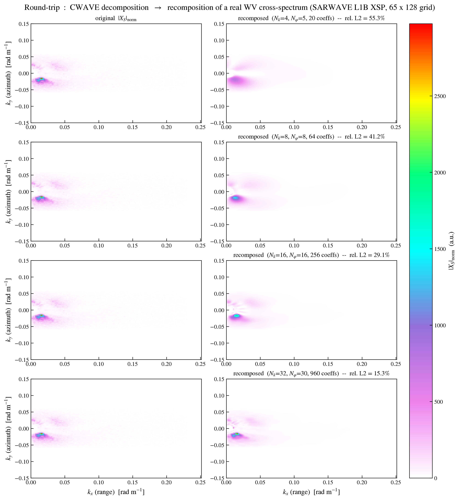

   Round trip of the S1A WV1 cross-spectrum. Rows:
   :math:`N_k \times N_\varphi` = 4 x 5, 8 x 8, 16 x 16, 32 x 30 (20, 64,
   256, 960 coefficients). Left: original spectrum. Right: reconstruction
   from the CWAVE coefficients, with the relative L2 error in the title.

The relative L2 error decreases monotonically as the kernel set grows :
55.25 % -> 41.15 % -> 29.11 % -> **15.33 %** for 20 -> 64 -> 256 -> 960
coefficients, and the fraction of the domain-:math:`A` L2 energy captured by
the reconstruction rises from 69.5 % (default 4 x 5) to 97.65 % (32 x 30).
This is the signature of an orthogonal projection : the reconstruction is the
projection of the spectrum onto the span of the kernel, and at 32 x 30 the
residual is exactly the 2.35 % of the L2 energy that lies outside the
960-dimensional span (:math:`15.33\,\% = \sqrt{1 - 0.9765}`).

**15 % is the best reachable on this real product, and the residual is not an
implementation artefact.** Two independent limits set the floor :

- the real cross-spectrum carries fine, noise-like structure (bragg ripples,
  backscatter speckle) that lives in the ~7300 grid dimensions orthogonal to
  the 960-dimensional kernel span — no choice of 960 coefficients can
  represent it;
- the product grid is 65 x 128, i.e. only 65 azimuth samples : the number of
  resolvable angular modes is limited by the Nyquist frequency, so
  :math:`N_\varphi = 30` is already near the limit. Enlarging the kernel set
  beyond it (40 x 35) **increases** the error to 17.13 % — the higher-order
  kernels are under-sampled on the coarse grid.

Conversely, on a **smooth** synthetic spectrum (two Gaussians, i.e. the kind
of signal the basis is designed to hold) the same library path converges to
near-perfect reconstruction : 68.8 % -> 49.5 % -> 16.3 % -> **3.7 %** relative
L2 at 4 x 5, 8 x 8, 16 x 16, 32 x 30, still decreasing. So "many CWAVE
coefficients reconstruct the spectrum perfectly" is true in principle; the
~15 % floor on the real acquisition is the spectrum's fine structure plus the
grid resolution, not a defect of the code.

The orthonormality that underlies this back-and-forth is checked directly : on
a fine 400 x 400 grid with the paper parameters, the Gram matrix of the
kernels on the one-sided domain :math:`A` has diagonal
:math:`1.000 \pm 0.004` (min 0.996, max 1.006) and off-diagonal entries below
0.4 % of the diagonal. The unit tests
(:mod:`tests/test_cwaves`) certify all of the above on the same WV fixture :
``test_cwave_roundtrip_reconstruction`` (round-trip error and pixel-to-pixel
tolerances), ``test_cwave_roundtrip_energy_balance`` (discrete Parseval
identity between the coefficients and the residual),
``test_cwave_roundtrip_convergence`` (captured energy is non-decreasing for
nested kernel sets) and ``test_compute_kernel_orthonormality`` (the kernel
Gram matrix, for which the historical ``xsar_slc`` ``eta`` bug used to give a
24-39 % off-diagonal contamination).

Case study: Galicia -> Ireland (15 S1B IW XSP products)
-------------------------------------------------------

The tool :mod:`cwaves.scripts.cwave_listing_compare`
(console script ``cwaves-listing-compare``) maps the CWAVE parameters of a
**listing** of SARWAVE L1B IW XSP products and compares them, parameter by
parameter, with the CWAVE parameters already embedded in the product by the
**historical** ``xsar_slc`` pipeline (variable ``cwave_params``, computed in a
different way : symmetrized spectrum, different normalisation). For the
Galicia -> Ireland case-study of 2021-02-27 18h (15 S1B IW XSP SAFEs, intraburst,
lag 2, VV, 1558 tiles) it produced one georeferenced map and one
library-vs-``xsar_slc`` scatter per CWAVE parameter (20 of each). Five
representative parameters are shown below : for each, the georeferenced map of
the library values (all three subswaths ``iw1``/``iw2``/``iw3`` colocated in
geographic space, colour = subswath) and the old-vs-new scatter (one point per
tile, 1:1 line).

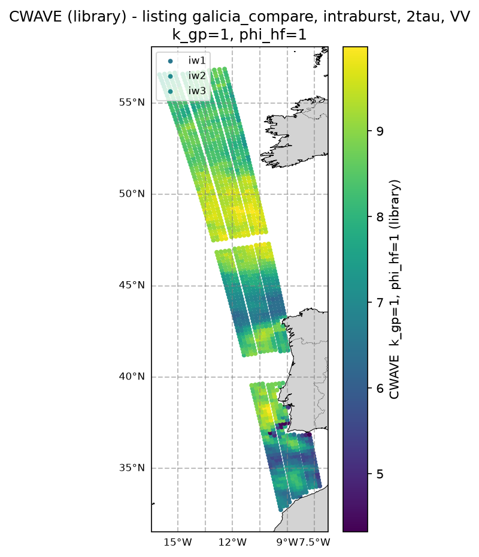

   Georeferenced CWAVE map (:math:`k_{gp}=1`, :math:`\varphi_{hf}=1`) of the
   library values over the 15 SAFEs.

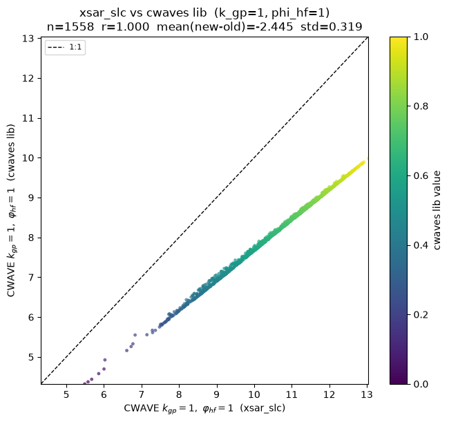

   Library vs ``xsar_slc`` CWAVE (:math:`k_{gp}=1`, :math:`\varphi_{hf}=1`).

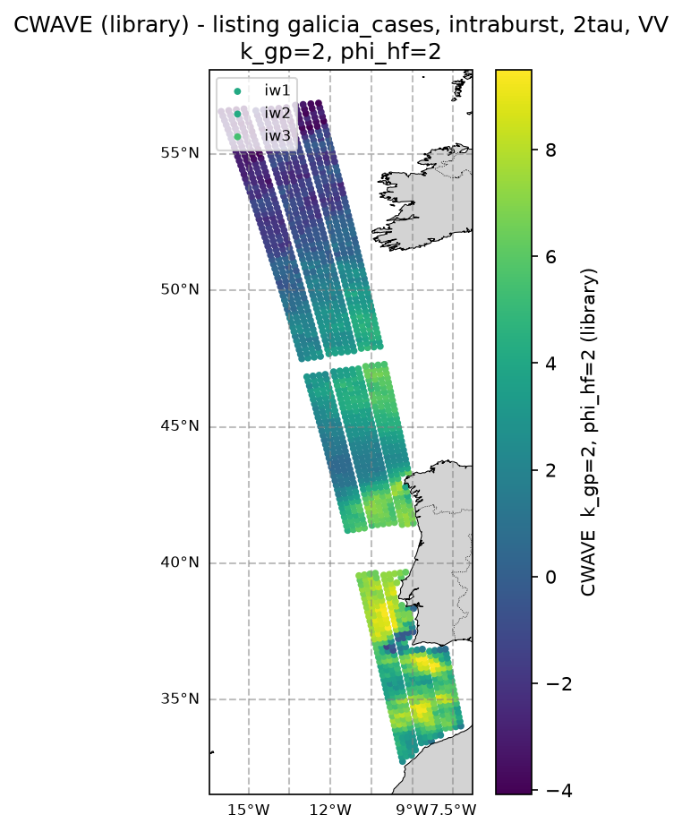

   Georeferenced CWAVE map (:math:`k_{gp}=2`, :math:`\varphi_{hf}=2`).

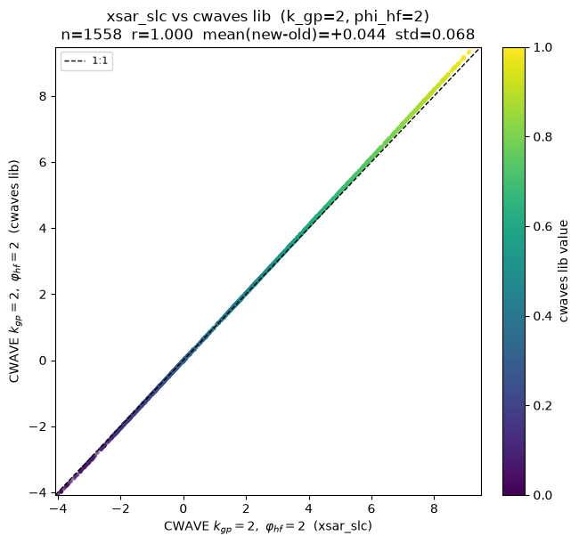

   Library vs ``xsar_slc`` CWAVE (:math:`k_{gp}=2`, :math:`\varphi_{hf}=2`).

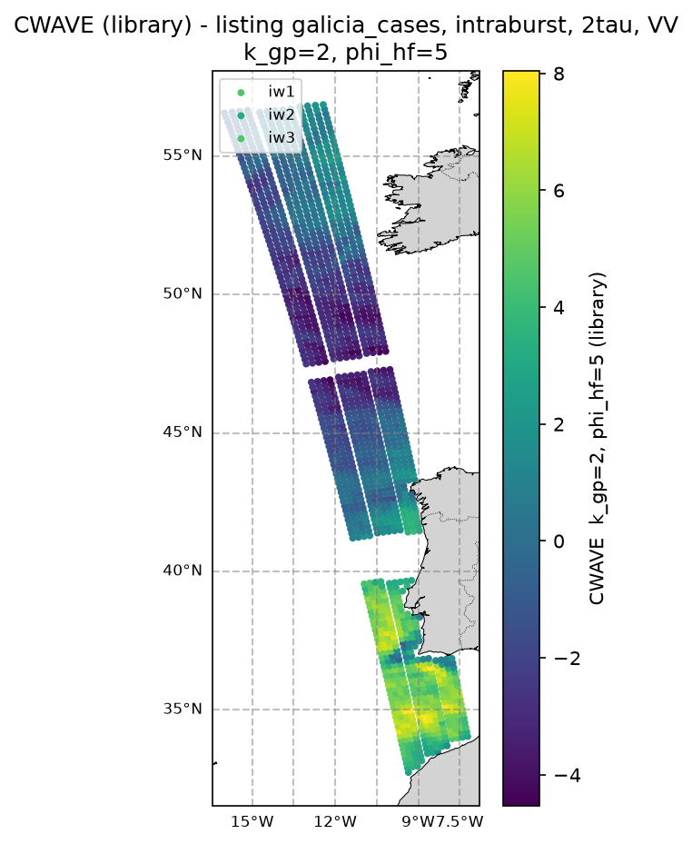

   Georeferenced CWAVE map (:math:`k_{gp}=2`, :math:`\varphi_{hf}=5`).

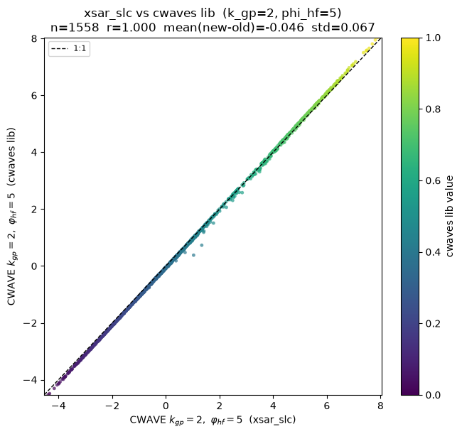

   Library vs ``xsar_slc`` CWAVE (:math:`k_{gp}=2`, :math:`\varphi_{hf}=5`).

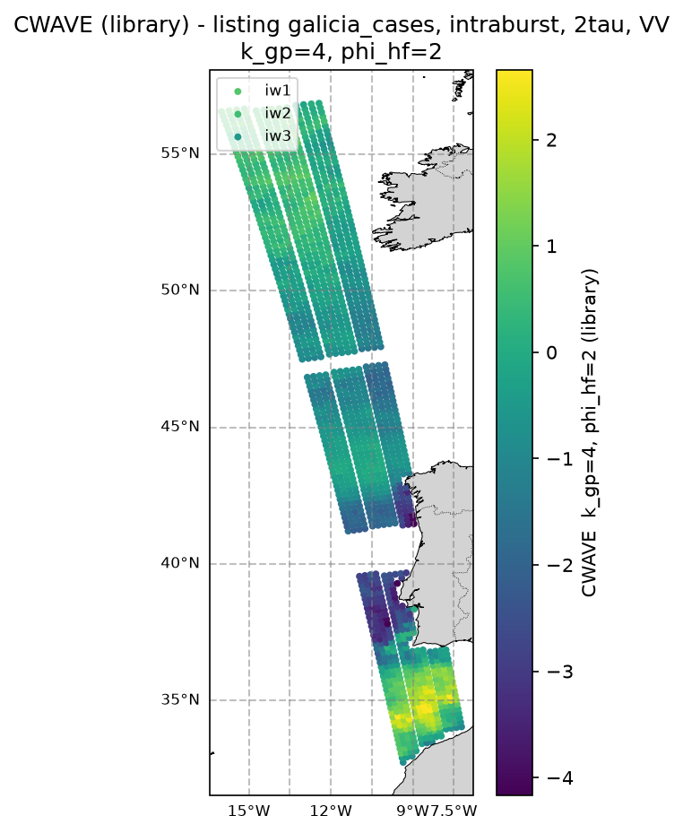

   Georeferenced CWAVE map (:math:`k_{gp}=4`, :math:`\varphi_{hf}=2`).

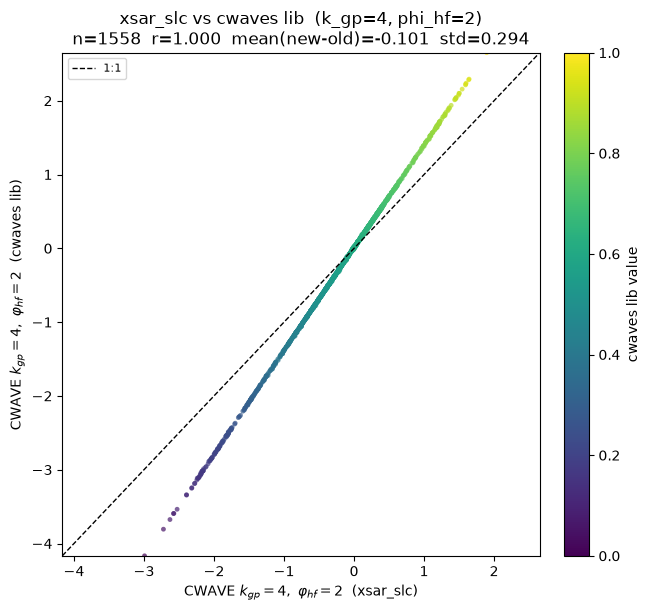

   Library vs ``xsar_slc`` CWAVE (:math:`k_{gp}=4`, :math:`\varphi_{hf}=2`).

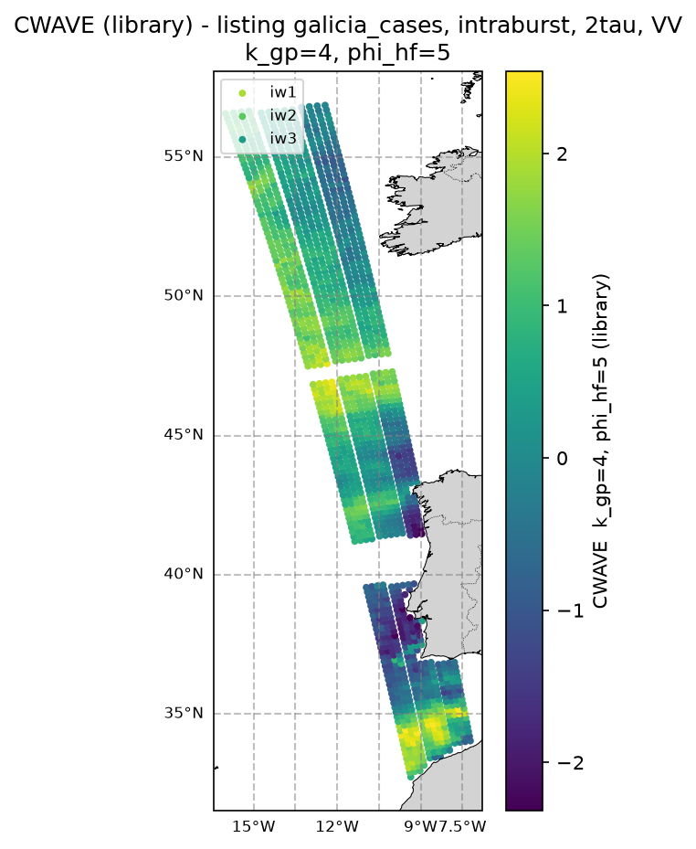

   Georeferenced CWAVE map (:math:`k_{gp}=4`, :math:`\varphi_{hf}=5`).

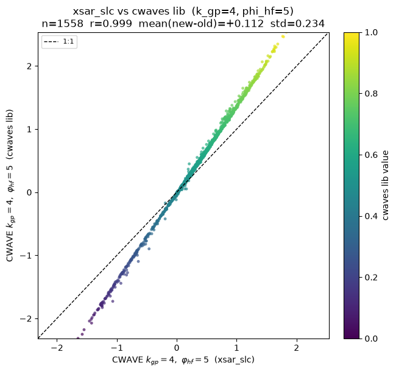

   Library vs ``xsar_slc`` CWAVE (:math:`k_{gp}=4`, :math:`\varphi_{hf}=5`).

The two implementations agree very closely: for every parameter the Pearson
correlation is :math:`r \ge 0.999` and the mean library-minus-``xsar_slc`` bias
is small (well below the inter-tile variability), confirming the library is
consistent with the historical pipeline.

Reproducing the figures
-----------------------

The kernel and cross-spectrum figures are generated by
:file:`docs/generate_figures.py` :

.. code-block:: bash

   python docs/generate_figures.py

The source fixtures are shipped in :file:`assets/`.

The Galicia -> Ireland case-study figures are produced by the compare tool on a
listing of SARWAVE XSP products (the georeferenced maps need ``cartopy``, the
``scripts`` extra). The five parameters shown above are rendered with
``--cases`` :

.. code-block:: bash

   python -m cwaves.scripts.cwave_listing_compare \
       --input-listing <galicia2ireland_IW_L1B_XSP.txt> \
       --output-dir <out_dir> \
       --cases 1,1;2,2;2,5;4,2;4,5

Without ``--cases`` it renders the full 4 x 5 = 20 parameters. For every case it
writes one ``cwave_map_k{kg}_phi{ph}.png`` (georeferenced map, library values)
and one ``compare_cwave_k{kg}_phi{ph}.png`` (library vs ``xsar_slc`` scatter),
plus a ``compare_summary.txt`` (n, Pearson r, mean bias, std).
