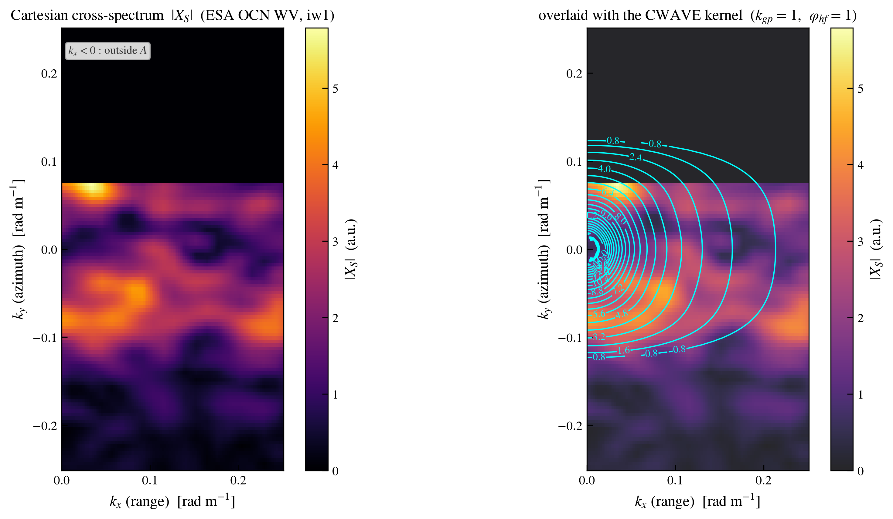

Certification
=============

.. _certification:

This page certifies that the CWAVE kernels are consistent with the structure of
real SAR ocean cross-spectra, and shows a full georeferenced CWAVE map produced
by the task-10 script.

Kernels superimposed on a real cross-spectrum
---------------------------------------------

The figure below shows a **real ESA OCN WV Sentinel-1 cartesian
cross-spectrum** (``oswCartSpecRe``/``oswCartSpecIm``, one ``iw1`` tile, lag 2,
resampled onto the regular one-sided grid) together with the CWAVE kernel
(:math:`k_{gp}=1`, :math:`\varphi_{hf}=1`) **superimposed** as contours.

   Left: the cartesian cross-spectrum :math:`|X_S|` (one tile). Right: the same
   cross-spectrum with the CWAVE kernel contours (:math:`k_{gp}=1`,
   :math:`\varphi_{hf}=1`) overlaid in cyan. The kernel ellipses are elongated
   along the range direction (:math:`k_x`), matching the spectral structure.

The elliptic, range-elongated support of the kernel follows the domain :math:`A`
and is consistent with the dominant lobes of the cross-spectrum, which is the
intended behaviour of the orthonormal basis on :math:`A`.

Georeferenced CWAVE map
-----------------------

The figure below is a georeferenced map of the CWAVE parameter
(:math:`k_{gp}=1`, :math:`\varphi_{hf}=1`) produced by the task-10 script
(:mod:`cwaves.scripts.iw_cwaves_map`) on two Sentinel-1 IW product families :
the ESA OCN WV IW osw fixture (``iw1``) and the SARWAVE L1B XSP fixture
(``iw2``).

.. figure:: figures/cwave_map_k1_phi1.png
   :align: center
   :width: 100%

   Georeferenced CWAVE map (:math:`k_{gp}=1`, :math:`\varphi_{hf}=1`),
   intraburst, lag 2. Each point is one tile; the two clusters correspond to the
   two (reduced) fixture products.

The map is rendered with ``cartopy`` (the ``scripts`` extra) with labeled
longitude/latitude gridlines; the colour scale is shared across subswaths.

Reproducing the figures
-----------------------

Both figures are generated by :file:`docs/generate_figures.py` :

.. code-block:: bash

   python docs/generate_figures.py

The map figure requires the ``scripts`` extra (``pip install "cwaves[scripts]"``
for ``cartopy``). The source fixtures are shipped in :file:`assets/`.
