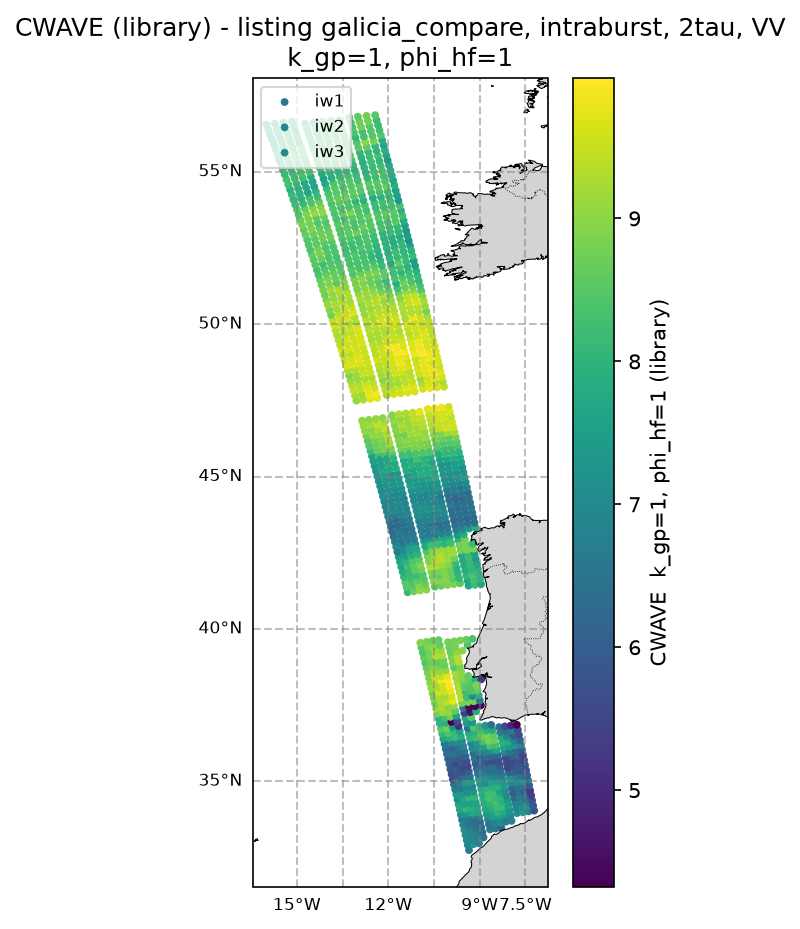
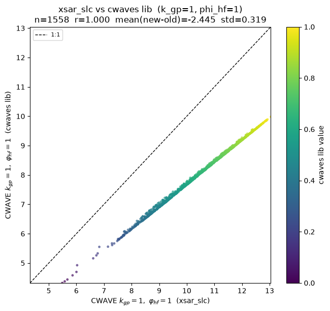
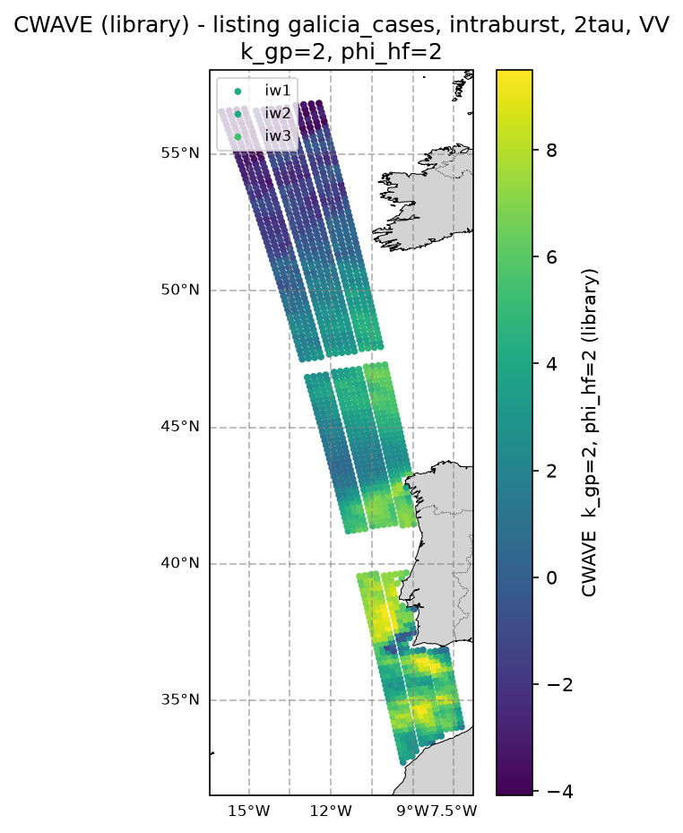
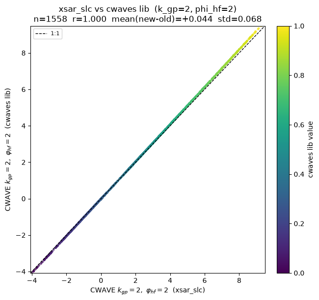
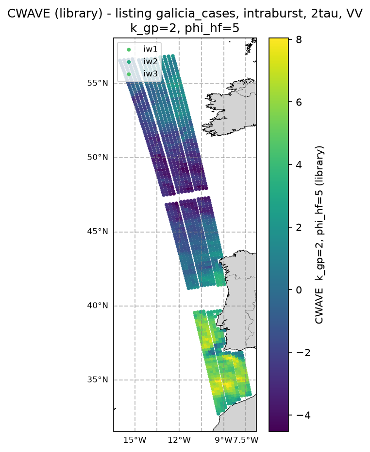
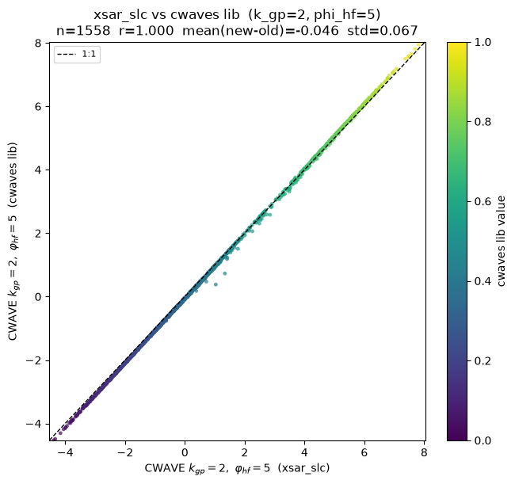
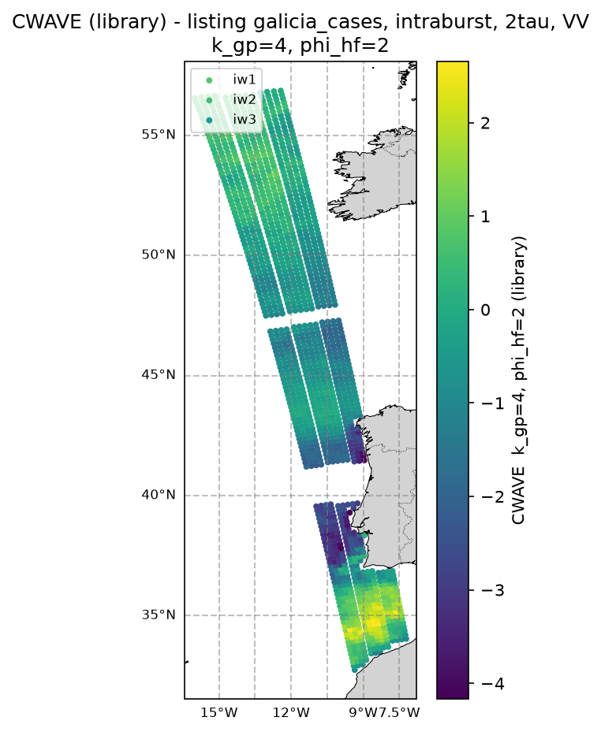
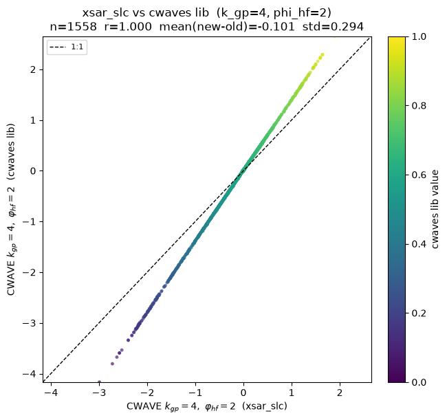
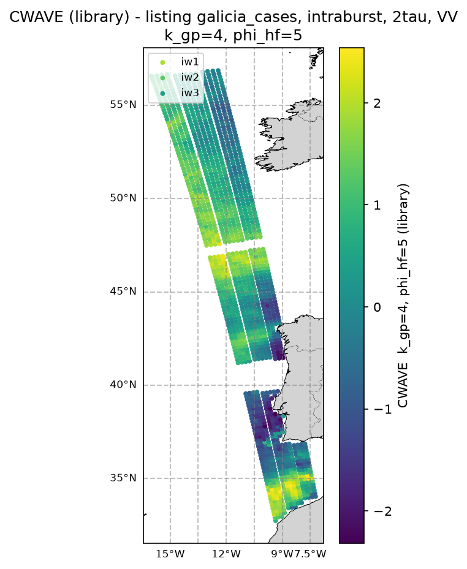
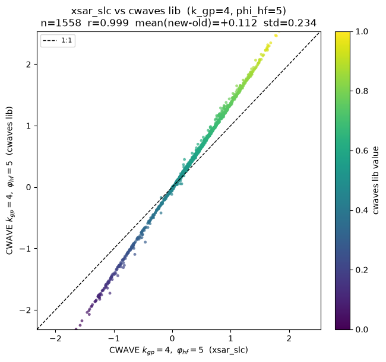

Certification
=============

.. _certification:

This page certifies that the CWAVE kernels are consistent with the structure of
real SAR ocean cross-spectra, and shows a full georeferenced CWAVE map produced
by the task-10 script.

From surface roughness to CWAVE on real data
--------------------------------------------

The chain is : the sea-surface roughness modulates the radar backscatter
:math:`\sigma^0`, which the SAR cross-spectra represent in the wavenumber
domain, from which the CWAVE parameters are extracted. All the figures below
come from the **same S1A WV1 acquisition** (2025-05-01, orbit 058996_075117,
OCN WV measurement base name
``s1a-wv1-ocn-vv-20250501t060101-058996-075117-001``, derived from the SLC
``S1A_WV_SLC__1SSV_20250501T060101_20250501T061923_058996_075117_DD24``).

SAR roughness
~~~~~~~~~~~~~

.. figure:: figures/s1a-wv1-slc-vv-20250501t060101-20250501t060104-058996-075117-001-roughness.png
   :align: center
   :width: 60%

   SAR :math:`\sigma^0` roughness image of the sea surface (S1A WV1, VV). The
   modulations of this surface are what the cross-spectra below encode in the
   wavenumber domain.

Cross-spectra and CWAVE kernels
~~~~~~~~~~~~~~~~~~~~~~~~~~~~~~~

Each of the three figures below shows, for one decode method, three panels : the
modulus :math:`|X_S|`, the same spectrum with the CWAVE kernel
(:math:`k_{gp}=1`, :math:`\varphi_{hf}=1`) **superimposed** as contours, and the
**pointwise integrand** :math:`\text{kernel} \times |X_S|_{\text{norm}}` that is
summed over the domain to yield the CWAVE parameter (the intermediate step of
:func:`cwaves.compute_cwaves.compute_cwave_parameters`). All three are plotted
on the **same display domain** :math:`k_x \in [0, k_{max}]`,
:math:`k_y \in [-k_{max}, k_{max}]` (black = zero spectrum), so the panels are
directly comparable.

* **OCN WV, polar → cartesian** (``oswPolSpec`` resampled to a cartesian grid,
  :func:`cwaves.client.polar_to_cartesian`) :

  .. figure:: figures/certification_ocn_polar.png
     :align: center
     :width: 100%

* **OCN WV, cartesian-sinh → regular** (``oswCartSpec`` sinh grid decompressed
  to a regular one-sided grid in rad/m,
  :func:`cwaves.ocn_sinh.compute_ocn_sinh_cartesian`) :

  .. figure:: figures/certification_ocn_sinh.png
     :align: center
     :width: 100%

* **SARWAVE L1B XSP** (the self-contained ``xspectra_2tau`` cross-spectrum,
  :func:`cwaves.compute_cwaves_from_l1b`) :

  .. figure:: figures/certification_xsp.png
     :align: center
     :width: 100%

In each figure, the middle panel overlays the CWAVE kernel contours (cyan) on
:math:`|X_S|` -- the kernel ellipses are elongated along the range direction
(:math:`k_x`), matching the spectral structure -- and the right panel shows the
integrand, whose sum over the domain is the CWAVE value in the title.

The elliptic, range-elongated support of the kernel follows the domain :math:`A`
and is consistent with the dominant lobes of the cross-spectra, which is the
intended behaviour of the orthonormal basis on :math:`A`.

Full CWAVE basis (all 20 parameters)
~~~~~~~~~~~~~~~~~~~~~~~~~~~~~~~~~~~~

The three figures below render the **entire default CWAVE basis**
(:math:`N_k = 4` Gegenbauer x :math:`N_\varphi = 5` harmonic = 20 parameters)
for each decode method, on the same S1A WV1 acquisition as above. Each panel is
the pointwise integrand :math:`\text{kernel}_{(k_{gp},\,\varphi_{hf})} \times
|X_S|_{\rm norm}` for one parameter, with the resulting CWAVE value in the
title; the colour scale is shared (and symmetric) across all panels of a method,
so the 20-parameter output of the three decode methods is directly comparable.

* **OCN WV, polar → cartesian** :

  .. figure:: figures/certification_all_ocn_polar.png
     :align: center
     :width: 100%

* **OCN WV, cartesian-sinh → regular** :

  .. figure:: figures/certification_all_ocn_sinh.png
     :align: center
     :width: 100%

* **SARWAVE L1B XSP** :

  .. figure:: figures/certification_all_xsp.png
     :align: center
     :width: 100%

Case study: Galicia -> Ireland (15 S1B IW XSP products)
-------------------------------------------------------

The tool :mod:`cwaves.scripts.cwave_listing_compare`
(console script ``cwaves-listing-compare``) maps the CWAVE parameters of a
**listing** of SARWAVE L1B IW XSP products and compares them, parameter by
parameter, with the CWAVE parameters already embedded in the product by the
**historical** ``xsar_slc`` pipeline (variable ``cwave_params``, computed in a
different way : symmetrized spectrum, different normalisation). For the
Galicia -> Ireland case-study of 2021-02-27 18h (15 S1B IW XSP SAFEs, intraburst,
lag 2, VV, 1558 tiles) it produced one georeferenced map and one
library-vs-``xsar_slc`` scatter per CWAVE parameter (20 of each). Five
representative parameters are shown below : for each, the georeferenced map of
the library values (all three subswaths ``iw1``/``iw2``/``iw3`` colocated in
geographic space, colour = subswath) and the old-vs-new scatter (one point per
tile, 1:1 line).

   Georeferenced CWAVE map (:math:`k_{gp}=1`, :math:`\varphi_{hf}=1`) of the
   library values over the 15 SAFEs.

   Library vs ``xsar_slc`` CWAVE (:math:`k_{gp}=1`, :math:`\varphi_{hf}=1`).

   Georeferenced CWAVE map (:math:`k_{gp}=2`, :math:`\varphi_{hf}=2`).

   Library vs ``xsar_slc`` CWAVE (:math:`k_{gp}=2`, :math:`\varphi_{hf}=2`).

   Georeferenced CWAVE map (:math:`k_{gp}=2`, :math:`\varphi_{hf}=5`).

   Library vs ``xsar_slc`` CWAVE (:math:`k_{gp}=2`, :math:`\varphi_{hf}=5`).

   Georeferenced CWAVE map (:math:`k_{gp}=4`, :math:`\varphi_{hf}=2`).

   Library vs ``xsar_slc`` CWAVE (:math:`k_{gp}=4`, :math:`\varphi_{hf}=2`).

   Georeferenced CWAVE map (:math:`k_{gp}=4`, :math:`\varphi_{hf}=5`).

   Library vs ``xsar_slc`` CWAVE (:math:`k_{gp}=4`, :math:`\varphi_{hf}=5`).

The two implementations agree very closely: for every parameter the Pearson
correlation is :math:`r \ge 0.999` and the mean library-minus-``xsar_slc`` bias
is small (well below the inter-tile variability), confirming the library is
consistent with the historical pipeline.

Reproducing the figures
-----------------------

The kernel and cross-spectrum figures are generated by
:file:`docs/generate_figures.py` :

.. code-block:: bash

   python docs/generate_figures.py

The source fixtures are shipped in :file:`assets/`.

The Galicia -> Ireland case-study figures are produced by the compare tool on a
listing of SARWAVE XSP products (the georeferenced maps need ``cartopy``, the
``scripts`` extra). The five parameters shown above are rendered with
``--cases`` :

.. code-block:: bash

   python -m cwaves.scripts.cwave_listing_compare \
       --input-listing <galicia2ireland_IW_L1B_XSP.txt> \
       --output-dir <out_dir> \
       --cases 1,1;2,2;2,5;4,2;4,5

Without ``--cases`` it renders the full 4 x 5 = 20 parameters. For every case it
writes one ``cwave_map_k{kg}_phi{ph}.png`` (georeferenced map, library values)
and one ``compare_cwave_k{kg}_phi{ph}.png`` (library vs ``xsar_slc`` scatter),
plus a ``compare_summary.txt`` (n, Pearson r, mean bias, std).
