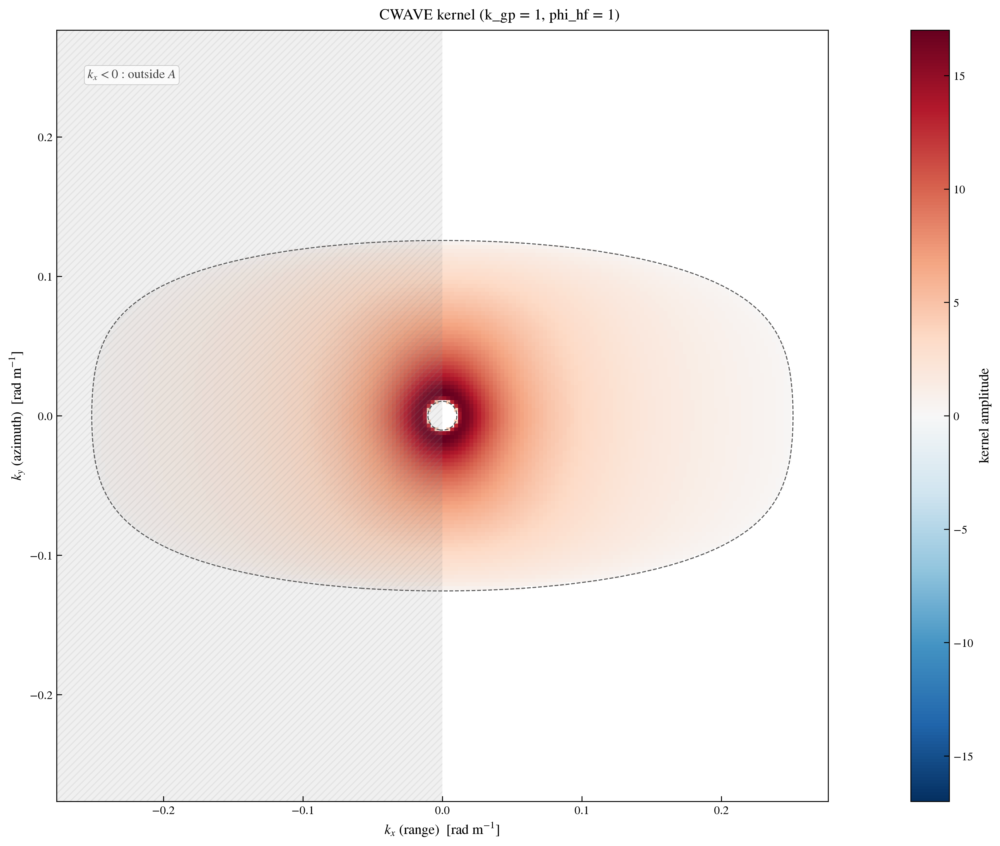
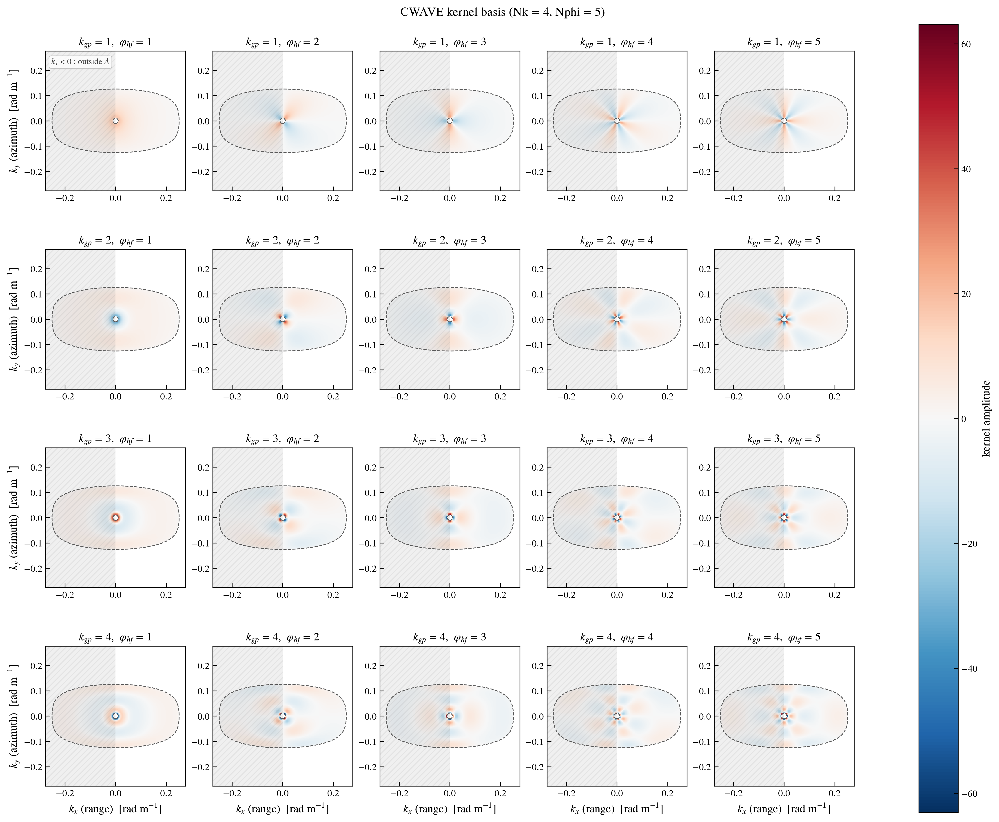

Theory
======

.. _theory:

The CWAVE method
----------------

``cwaves`` implements the **CWAVE** orthonormal kernel decomposition used to
retrieve integral ocean wave parameters from SAR data. The method is described
in the reference paper :

.. epigraph::

   J. Schulz-Stellenfleth, T. Konig, and S. Lehner, "An empirical approach for
   the retrieval of integral ocean wave parameters from synthetic aperture
   radar data", **J. Geophys. Res., 112, C03019, 2007.**
   `doi:10.1029/2006JC003970
   <https://agupubs.onlinelibrary.wiley.com/doi/full/10.1029/2006JC003970>`_

The kernel construction itself is standard orthogonal-polynomial theory :

.. epigraph::

   I. S. Gradshteyn and I. M. Ryzhik, "Table of Integrals, Series and
   Products", **7th ed., Elsevier, New York, 2000** (section 7.313 :
   orthogonality of the Gegenbauer polynomials :math:`C_n^{(\lambda)}`;
   section 7.112 : associated Legendre functions).

Gradshteyn & Ryzhik is the **primary mathematical reference**; the 2007 paper
is the application of that construction to SAR spectra.

The spectrum is projected onto a set of **orthonormal kernels**; the CWAVE
parameters are the coefficients of this projection (paper equations 25-26) :

.. math::

   c_{n,p} = \iint_A K_{n,p}(\mathbf{k})\, \hat f(\mathbf{k})\,
   \mathrm{d}A, \qquad
   \hat f = \frac{|f|}{\iint_{k_{min}<|\mathbf{k}|<k_{max}} |f|\,\mathrm{d}A}

where :math:`A` is the elliptic wavenumber domain of the paper (equations
B1-B13) and :math:`\hat f` the spectrum normalised to unit mass.

What the decomposition is, mathematically
-----------------------------------------

Each kernel is a product of three factors,

.. math::

   K_{n,p}(\mathbf{k}) = G_n(\alpha_k)\; F_p(\alpha_\varphi)\; \eta(\mathbf{k}),

with the coordinates :math:`(\alpha_k, \alpha_\varphi) \in [-1, 1] \times
[0, \pi]` of the half domain (:math:`\alpha_k` is linear in the logarithm of
the elliptic wavenumber, :math:`\alpha_\varphi` the direction).

* **Radial factor** :math:`G_n(x) = \sqrt{\tfrac{n+3/2}{(n+1)(n+2)}}\,
  C_n^{(3/2)}(x)\, \sqrt{1-x^2}`. By the Gradshteyn & Ryzhik orthogonality
  integral (7.313 with :math:`\lambda = 3/2`),
  :math:`\int_{-1}^{1}(1-x^2)\,[C_n^{(3/2)}]^2\,\mathrm{d}x
  = \tfrac{2(n+1)(n+2)}{2n+3}` **for every** :math:`n \ge 0`, so the
  coefficient makes the :math:`G_n` orthonormal on :math:`[-1, 1]`. Since
  :math:`\sqrt{1-x^2}\,C_n^{(3/2)}(x) \propto P^1_{n+1}(x)`, the :math:`G_n`
  are exactly the **normalised associated Legendre functions**
  :math:`P^1_{n+1}` (G&R 7.112; checked to :math:`10^{-15}`).
* **Angular factor** :math:`F_p`: the Fourier functions
  :math:`\{1/\sqrt\pi,\ \sqrt{2/\pi}\sin 2m\varphi,\ \sqrt{2/\pi}\cos
  2m\varphi\}` -- orthonormal and complete on any interval of length
  :math:`\pi`.
* **Measure factor** :math:`\eta` (paper equation B13) is *identically* the
  square root of the inverse Jacobian of :math:`(\alpha_k,\alpha_\varphi)
  \to (k_{rg}, k_{az})`: :math:`\eta^2 J = 1` (checked to
  :math:`10^{-16}`).

Consequence: writing :math:`g = f/\eta` on the rectangle,

.. math::

   c_{n,p} = \int_{-1}^{1}\!\!\int_0^{\pi} G_n(\alpha_k)\, F_p(\alpha_\varphi)\,
   g(\alpha_k, \alpha_\varphi)\; \mathrm{d}\alpha_\varphi\, \mathrm{d}\alpha_k ,

i.e. **CWAVE is a plain orthonormal (associated-Legendre x Fourier) expansion
of the spectrum, transported to the rectangle** :math:`[-1,1]\times[0,\pi]`.
:math:`\iint_A K_i K_j\,\mathrm{d}A = \delta_{ij}` holds exactly in the
continuum, and the basis is **complete**: with enough coefficients any
(square-integrable) spectrum on the half domain is represented. This is the
precise sense in which the library is an *exact* implementation of the
Gradshteyn & Ryzhik construction. The 1-D orthonormality of the angular and
radial factors is also formally proven in Lean 4 (:ref:`proofs`).

The kernel basis
----------------

   A single CWAVE kernel (:math:`k_{gp}=1`, :math:`\varphi_{hf}=1`) on the
   elliptic domain :math:`A`.

   The default kernel basis (rows = Gegenbauer index :math:`k_{gp}`, columns =
   harmonic index :math:`\varphi_{hf}`).

.. _axis-convention:

Axis convention
---------------

* :math:`k_x` is the **range** wavenumber (``k_rg``), :math:`k_y` the
  **azimuth** wavenumber (``k_az``) -- the convention of the latest
  ``xsar_slc`` commits;
* the major axis of the kernel domain lies along the range direction (the
  4th-order bunching term of the paper acts on the azimuth wavenumber);
* the angle used by the kernels is
  :math:`\alpha_\varphi = \operatorname{atan2}(k_{rg}, k_{az})`: the paper's
  axes are relabelled with respect to the library's (see
  ``repository_specifications.md`` section 4); this choice is documented and
  consistent with the physics of the products.

Half plane, full plane and symmetry
-----------------------------------

The angular functions above are :math:`\pi`-periodic, hence the kernels are
**even**: :math:`K(-\mathbf{k}) = K(\mathbf{k})`. Two equivalent statements
follow:

* on the **half plane** :math:`k_{rg} \ge 0` (:math:`\alpha_\varphi \in
  [0, \pi]`) the basis is orthonormal and complete: it represents *any*
  function given on the half plane;
* on the **full plane** the same kernels have norm :math:`\sqrt 2` and span
  only the **centrally-symmetric** functions. Integrated over the full plane
  (with the full-plane mass), they return exactly the CWAVE parameters of the
  centrally-symmetric part :math:`(f(\mathbf{k}) + f(-\mathbf{k}))/2`.

A SAR image is real, so its Fourier transform is Hermitian and every
cross-spectrum (any lag: 0-, 1-, 2-tau) satisfies :math:`X(-\mathbf{k}) =
\overline{X(\mathbf{k})}`: the half plane holds **all** the information, the
modulus :math:`|X|` and the real part are centrally symmetric, the imaginary
part is anti-symmetric. :func:`cwaves.compute_cwaves` therefore accepts both
half-plane and full-plane inputs (the coverage is detected from the
coordinates); for a Hermitian spectrum the two give the same parameters.
A *directional* wave spectrum (ambiguity removed, e.g. a model spectrum or the
OCN ``oswPolSpec``) is not centrally symmetric: CWAVE only encodes its
centrally-symmetric part (see :ref:`limits`).

.. _complex-cwave:

Complex spectra: even and odd harmonics
---------------------------------------

The imaginary part of a cross-spectrum is anti-symmetric: on the half plane it
changes sign between :math:`(0, k_{az})` and :math:`(0, -k_{az})`. The
:math:`\pi`-periodic harmonics of the paper cannot follow that sign change
(Gibbs effect at the :math:`k_{rg} = 0` edge, very slow convergence). The
natural basis is the :math:`\pi`-**antiperiodic** set
:math:`\{\sqrt{2/\pi}\cos(2m+1)\varphi,\ \sqrt{2/\pi}\sin(2m+1)\varphi\}`
(``harmonic_functions(..., parity="odd")``) -- also orthonormal and complete on
:math:`[0, \pi]`, with **the same radial (Gradshteyn & Ryzhik) factor and the
same** :math:`\eta`. Together the even and odd sets form the full Fourier basis
of the circle, so this extension stays within the same mathematical
construction. :func:`cwaves.compute_cwaves` exposes it with ``part``:

* ``"modulus"`` (default, the paper) : :math:`|f|` on the even harmonics;
* ``"real"`` : :math:`\operatorname{Re} f` on the even harmonics;
* ``"imag"`` : :math:`\operatorname{Im} f` on the odd harmonics;
* ``"complex"`` : :math:`c = c_{even}[\operatorname{Re} f] + i\,
  c_{odd}[\operatorname{Im} f]`.

All four share the same normalisation (mass of :math:`|f|`). On a smooth
synthetic Hermitian spectrum (native grid, 48 radial functions) the imaginary
part is reconstructed to :math:`4\cdot10^{-5}` relative L2 with 33 odd
harmonics, versus 0.26 with 33 even ones. On the real S1A WV1 L1B XSP asset
the imaginary part is weak (8-15 % of the real part) and dominated by
out-of-span fine structure, so both bases reach the same L2 floor (~0.5); but
the imaginary CWAVE parameters **double from 1-tau to 2-tau** (slope
1.96-1.99, correlation 0.996-0.999) while the real ones change by 2-3 %: the
phase of a cross-spectrum grows like :math:`\omega(k)\,\tau`, so these
coefficients carry coherent physical information (wave propagation), not
noise.

.. _any-grid:

Any input grid: the quadrature
------------------------------

The projection is a 2-D integral; the grid on which the spectrum is sampled
only enters through the **quadrature rule**. :mod:`cwaves.grid` builds, for
every sample, its cell (mid-points between neighbours) and the exact cell
area:

* **cartesian** grids (``k_rg``/``k_az``), uniform (FFT) or not (sinh grid of
  the OCN ``oswCartSpec``): area :math:`\Delta k_{rg}\,\Delta k_{az}`;
* **polar** grids (``k``/``phi``, radians, :math:`k_{rg} = k\cos\varphi`),
  linear or log-spaced :math:`k`: area :math:`(k_+^2 - k_-^2)/2\;
  \Delta\varphi` (geometric cell boundaries for a log grid, periodic cells for
  a full circle);
* on a half-plane grid the cells are fitted to the :math:`k_{rg} = 0` edge
  (the cell of a :math:`k_{rg} = 0` sample keeps only its inner half; a grid
  whose :math:`k_{rg} = 0` column was dropped, as in the SARWave L1B XSP, still
  covers the :math:`[0, \Delta k/2]` strip).

The spectrum is **never resampled**. The same analytic spectrum sampled on a
fine cartesian grid, a 70 x 139 sinh grid and an 80 x 144 log-polar grid gives
the same parameters to :math:`2\cdot10^{-6}`; the half-plane and the full-plane
versions of a Hermitian spectrum agree to the quadrature accuracy.

Corrected kernel implementation
-------------------------------

With respect to the historical ``xsar_slc`` reference, ``cwaves`` implements the
**corrected** orthonormal kernels :

* the Gegenbauer orthonormalization coefficient carries the missing
  :math:`\sqrt{\cdot}` (unit norm, paper equation B9), and
* :math:`\eta` is the **exact Jacobian** of the wavenumber mapping with the
  natural logarithm (paper equation B13).

The original ``xsar_slc`` implementation was missing the :math:`\sqrt{\cdot}`
and had a cancelling ``tmp`` term in :math:`\eta`, which made the kernels
non-orthogonal (about 24-39 % deviation). See ``repository_specifications.md``
(section 5) for the full investigation.

The limits of the decomposition and the choices made by the implementation are
listed in :ref:`limits`.
