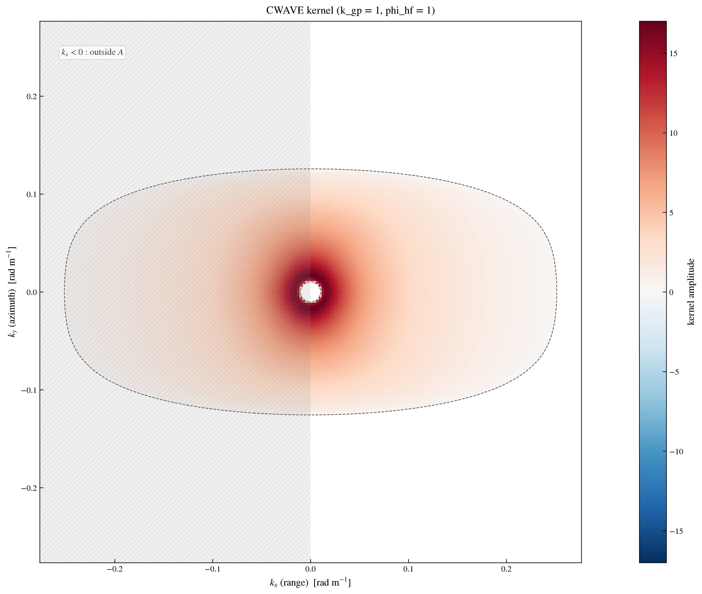
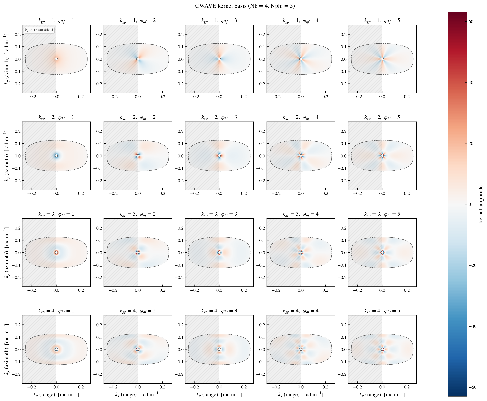

Theory
======

.. _theory:

The CWAVE method
----------------

``cwaves`` implements the **CWAVE** (cross-wave) orthonormal kernel
decomposition for the retrieval of integral ocean wave parameters from SAR
data. The method is described in the reference paper :

.. epigraph::

   J. Schulz-Stellenfleth, T. Konig, and S. Lehner, "An empirical approach for
   the retrieval of integral ocean wave parameters from synthetic aperture
   radar data", **J. Geophys. Res., 112, C03019, 2007.**
   `doi:10.1029/2006JC003970
   <https://agupubs.onlinelibrary.wiley.com/doi/full/10.1029/2006JC003970>`_

The kernel construction itself follows the standard orthonormal Gegenbauer
theory :

.. epigraph::

   I. S. Gradshteyn and I. M. Ryzhik, "Table of Integrals, Series and
   Products", **7th ed., Elsevier, New York, 2000** (section 7.313 :
   orthonormality of :math:`C_n^{(3/2)}` with the :math:`(1-x^2)` weight).

Gradshteyn & Ryzhik is the **primary mathematical reference**; the 2007 paper
above is the application of that construction to the SAR cross-spectrum.

Instead of first retrieving the full 2D ocean wave spectrum, the CWAVE method
projects the SAR **cross-spectrum** directly onto a set of **orthonormal
kernels**. Each kernel is a tensor product of

* a **Gegenbauer polynomial** :math:`C_n^{(3/2)}` (wavenumber direction), and
* a **pi-periodic harmonic function** (angle direction),

weighted by the **Jacobian** :math:`\eta` of the wavenumber mapping. The CWAVE
parameters are the coefficients of this projection :

.. math::

   C_{n,m} = \iint_A K_{n,m}(k_x, k_y)\, |X_S(k_x, k_y)| \, \mathrm{d}k_x\,
   \mathrm{d}k_y

where :math:`A` is the elliptic wavenumber domain (paper equations B1-B13) and
:math:`|X_S|` is the real, non-negative modulus of the cross-spectrum.

The orthonormality of the kernel basis on :math:`A` is the property that makes
the decomposition well-posed. The angular part of it (the harmonics
:math:`F_m` on :math:`[-\pi/2, \pi/2]`) is formally verified in Lean 4 — see
:ref:`proofs`.

The kernel basis
----------------

   A single CWAVE kernel (:math:`k_{gp}=1`, :math:`\varphi_{hf}=1`) over the
   elliptic domain :math:`A`. The hatched half (:math:`k_x < 0`) is outside the
   integration domain and is not integrated.

The full kernel basis (default :math:`N_k=4`, :math:`N_{\varphi}=5`) is shown
below. Each panel is one kernel :math:`K_{n,m}`; the elliptic support is the
domain :math:`A`, and the characteristic elongation is along the range
direction.

   The CWAVE kernel basis (rows = Gegenbauer index :math:`k_{gp}`, columns =
   harmonic index :math:`\varphi_{hf}`).

.. _axis-convention:

Axis convention
---------------

The wavenumber axes follow the convention of the latest ``xsar_slc`` commits :

* :math:`k_x` is the **range** wavenumber (``k_rg``, dimension
  ``freq_sample``),
* :math:`k_y` is the **azimuth** wavenumber (``k_az``, dimension
  ``freq_line``),
* the **major axis of the kernel ellipses lies along the range direction**
  (:math:`k_x`).

This is why the kernels appear elongated horizontally in the figures above
(:math:`k_x` on the horizontal axis).

One-sided (half) domain, no symmetrization
------------------------------------------

The CWAVE parameters are computed **directly on the one-sided (half) range
domain** (:math:`k_x = k_{rg} \ge 0`), using only the real modulus
:math:`|X_S|`, and **without symmetrization** — exactly as in the 2007 paper
(equations 25-26 and B1). A full / symmetrized (two-sided range) spectrum is
rejected with a ``ValueError``. See :ref:`usage` for the input contract and
``repository_specifications.md`` (section 6) for the full rationale.

Corrected kernel implementation
-------------------------------

With respect to the historical ``xsar_slc`` reference, ``cwaves`` implements the
**corrected** orthonormal kernels :

* the Gegenbauer orthonormalization coefficient carries the missing
  :math:`\sqrt{\cdot}` (unit norm, paper equation B9), and
* :math:`\eta` is the **exact Jacobian** of the wavenumber mapping with the
  natural logarithm (paper equation B13).

The original ``xsar_slc`` implementation was missing the :math:`\sqrt{\cdot}`
and had a cancelling ``tmp`` term in :math:`\eta`, which made the kernels
non-orthogonal (about 24-39 % deviation). See ``repository_specifications.md``
(section 5) for the full investigation.

Direct polar-grid computation
-----------------------------

The CWAVE projection of the first section is a plain 2-D integral over the
wavenumber domain, so it can be evaluated on **any** wavenumber grid. For a
spectrum natively sampled on a polar grid (the ESA OCN WV product's
``oswPolSpec`` : log-spaced wavenumber magnitude :math:`k` x uniform angle
:math:`\varphi`), :func:`cwaves.compute_cwave_parameters_polar` integrates it
**directly in polar coordinates**, without resampling to a cartesian grid.
The area element is the polar one,

.. math::

   \mathrm{d}A = \mathrm{d}k_x\, \mathrm{d}k_y = k\, \mathrm{d}k\,
   \mathrm{d}\varphi,

so each cell weight is the exact polar cell area
:math:`k_i\, \Delta k_i\, \Delta\varphi_j` (geometric-mean cell boundaries in
:math:`k` — exact for the OCN log-spaced grid — and periodic cell widths in
:math:`\varphi`). The rest of the input contract is identical to the cartesian
path :

* the real, non-negative modulus :math:`|spec|` is used (the complex phase is
  discarded),
* the integration is over the elliptic domain :math:`A` intersected with the
  wavenumber annulus — the circular annulus
  :math:`k_{min} < \sqrt{k_x^2 + k_y^2} < k_{max}` is exactly
  :math:`k_{min} < k < k_{max}` in polar coordinates,
* the one-sided (half) range domain :math:`k_x \ge 0` is
  :math:`\cos\varphi \ge 0` in polar coordinates,
* the normalized spectrum has unit mass over that one-sided annulus (cells
  outside :math:`A` stay in the mass and are excluded from the integral by the
  kernel's mask, exactly as in the cartesian path).

The OCN product's :math:`\varphi = 0` is the **range** direction
(:math:`k_x = k\cos\varphi`), the same convention as
:func:`cwaves.client.polar_to_cartesian`. On the real S1A WV1 OCN asset the
polar-direct path and the cartesian (128 x 128) path agree within 9.3 %
relative on every parameter of magnitude above 5 (see
:ref:`polar-direct-certification`);
the residual is the quadrature error of the product's own coarse 72 x 60
polar grid, shared by both paths.
